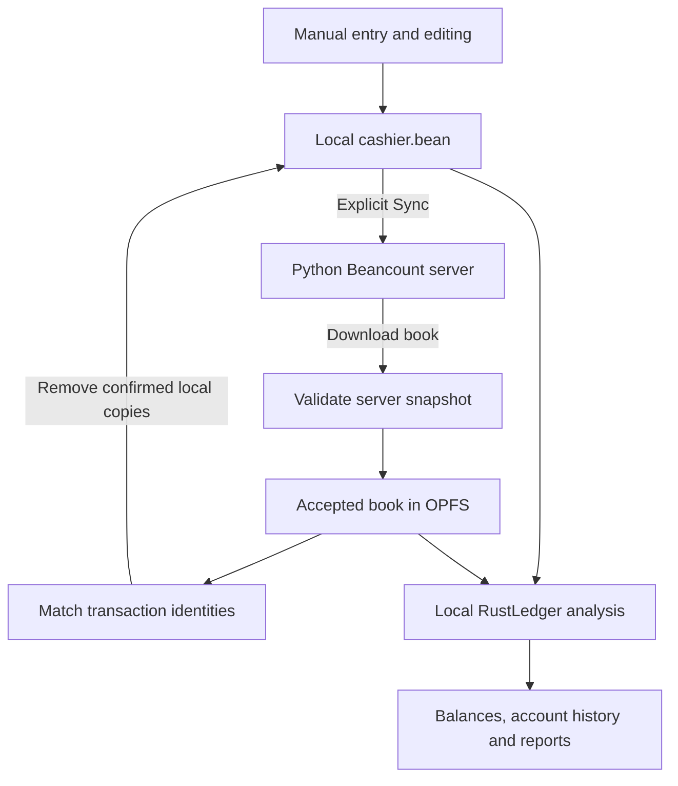

# Cashier architecture

## System overview

Cashier is a client-server personal finance application using Beancount. The [Python server](https://github.com/sirily/cashier-server-python) owns the authoritative accounting book and accepts transactions. The PWA provides offline transaction capture, explicit server synchronization, and on-device calculations.

The client stores pending transactions and a downloaded copy of the server book. RustLedger WASM parses Beancount and runs financial queries locally. This lets the owner enter transactions, inspect account history, and use reports while offline.

## Data storage

| Data                                             | Storage                        | Responsibility                                                            |
| ------------------------------------------------ | ------------------------------ | ------------------------------------------------------------------------- |
| Authoritative accounting book                    | Server's Beancount workspace   | Server validation, accepted transactions, and snapshot preparation        |
| Pending transactions                             | `cashier.bean` in browser OPFS | Durable local journal, including completed `*` and incomplete `!` entries |
| Downloaded book                                  | Beancount files in OPFS        | Offline copy of the server data used for analysis                         |
| Settings, reference data, scheduled transactions | IndexedDB through Dexie        | Structured application data managed by `src/lib/data/db.ts`               |
| API credential                                   | Local settings in IndexedDB    | Bearer authentication for protected server requests                       |
| Parsed-book cache                                | Binary file in OPFS            | Faster loading of the local analysis book                                 |

**OPFS** (Origin Private File System) is disk storage managed by the browser for a particular website origin. It holds files that the application reads and writes. Its lifetime follows browser site data: clearing site data removes local files.

**IndexedDB** is the browser's structured local database. Cashier accesses it through Dexie.

The Python server supplies the accounting book and reference data through explicit Sync. The client persists the downloaded snapshot in OPFS and reference data in IndexedDB. Manual entry creates pending journal records on the device.

## Transaction flow

### Local capture

The editor saves transactions into `cashier.bean`. Saving completes through local storage, allowing immediate use offline. Completed entries use the `*` flag; incomplete entries use `!`.

`src/lib/services/ledgerService.ts` owns the local journal. Editing and deletion locate a directive through a `DirectiveSpan`, which describes its position in the source text. Replacing that span leaves surrounding directives in place. The replacement text determines the fields and metadata stored inside the edited transaction.

### Explicit synchronization

`src/lib/sync/sync-beancount.ts` orchestrates synchronization. `src/lib/sync/manual-writeback.ts` handles transaction preparation, submission, and local reconciliation.

With ledger-file synchronization enabled:

1. Prepare completed local entries and persist missing `cashier_id` values.
2. Submit entries to `POST /api/xact` using the configured Bearer credential.
3. Download the selected server book and validate the complete candidate snapshot.
4. Match local transaction identities against the accepted downloaded book, retaining entries rejected in this attempt.
5. Remove confirmed local copies and refresh local analysis.

A server acceptance response starts the confirmation process. Removal of a local copy follows confirmation in the successfully downloaded and validated server book. Entries awaiting confirmation remain in the local journal, and retries reuse their persisted identities.

Metadata-only synchronization refreshes selected reference data. The ledger-file option controls the transaction writeback and book-reconciliation sequence.

The server prepares snapshots with Python-plugin results materialized. The PWA validates the server snapshot separately from the pending local journal, then combines the accepted book with local entries for display and analysis.

### Identity

`cashier_id` is the persistent synchronization identity assigned to a local transaction before submission. It connects retries, server acceptance, and downloaded-book confirmation.

`DirectiveSpan` identifies a position within a particular local source text. Source positions serve local editing; persistent identities serve synchronization.

## Local calculations

| Component                                | Responsibility                                                              |
| ---------------------------------------- | --------------------------------------------------------------------------- |
| `src/lib/services/rustledger.ts`         | WASM initialization and shared parsing utilities                            |
| `src/lib/services/ledgerService.ts`      | Local journal parsing and source-position-aware editing                     |
| `src/lib/services/ledgerWorkerClient.ts` | Asynchronous client interface for full-book calculations                    |
| `src/lib/workers/ledger.worker.ts`       | Background worker owning the full-book RustLedger instance and binary cache |

Callers commonly import `ledgerWorkerClient` under the local name `fullLedgerService`.

The worker reads `.bean` files from OPFS into a file map and loads them through `Ledger.fromFiles`. `cashier.bean` is the analysis root. When a different configured user book and the journal are available, the worker adds the user-book include to the in-memory journal source. Stored source files retain their original content.

Balances, account history, and reports use asynchronous BQL queries against this combined book. **BQL** is the query language for selecting and aggregating Beancount data. The worker runs calculations in a background thread while the interface remains responsive.

The client exposes loading, availability, version, and reloading state. Reports use these signals to track freshness and distinguish results from pending or failed calculations.

The binary cache accelerates loading. An unusable cache triggers source parsing; source changes trigger invalidation and rebuilding.

## Credentials and local transfer

Protected API calls carry the locally configured token in the `Authorization: Bearer` header. Settings export filters out the API credential. The owner configures connection details and credentials through local settings controls.

Journal export produces transaction text for copying or downloading. Export leaves local entries and their synchronization identities in place.

Local backup contains settings and scheduled transactions. Journal files and the downloaded book have their own export paths.

## Packaging and contracts

The PWA is a static SvelteKit application packaged in Docker and served by Caddy. Its service worker supplies offline application assets; API requests use the network. Backend deployment and routing are managed in separate repositories.

Published behavior contracts are in `openspec/specs/`. Change proposals, designs, and tasks are in `openspec/changes/`. Release procedures are documented in [releasing.md](releasing.md).
